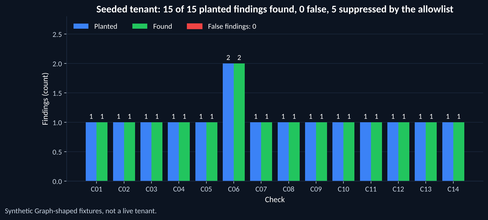
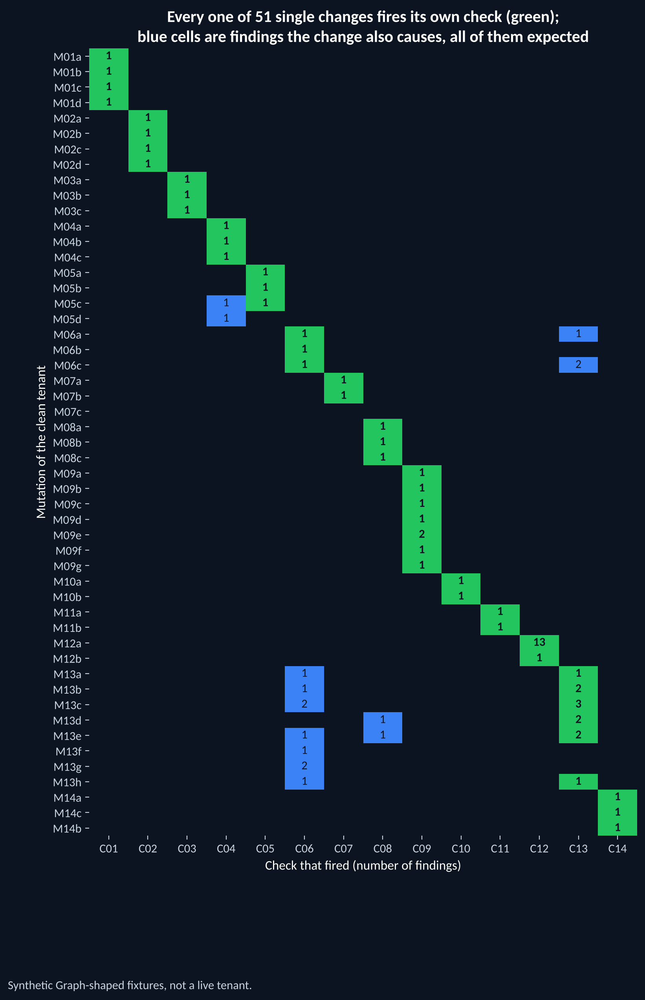
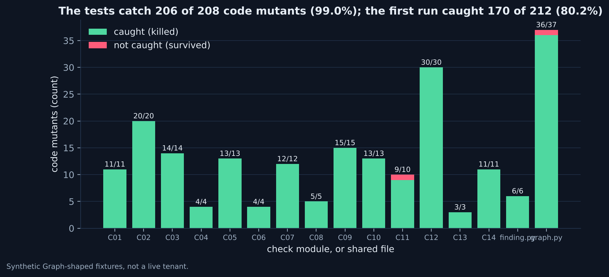
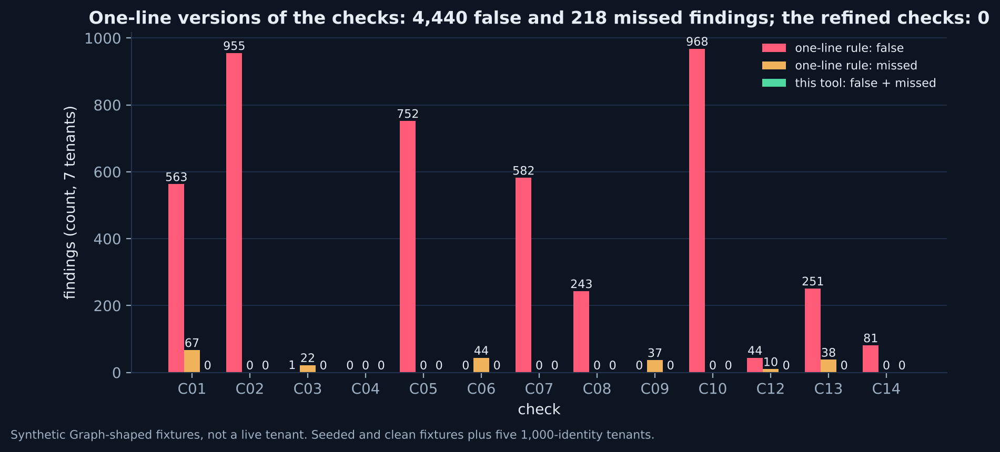
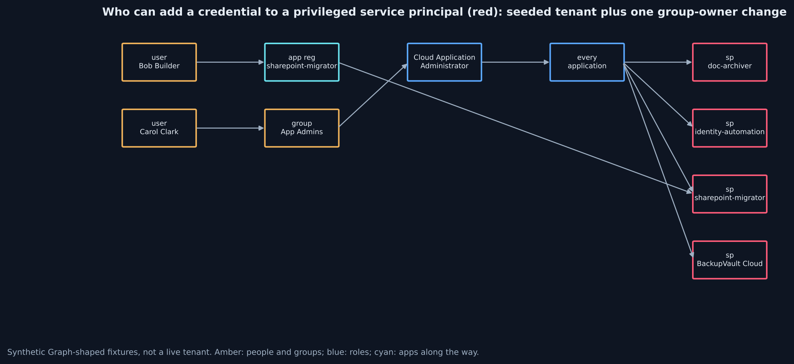
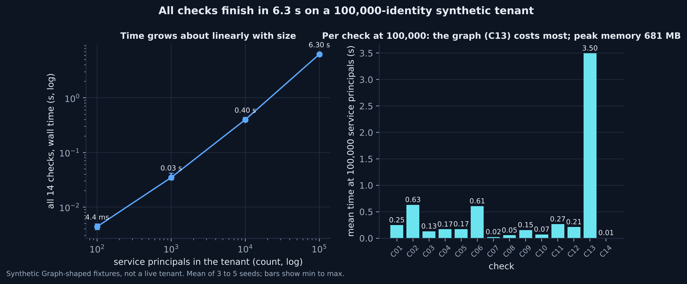
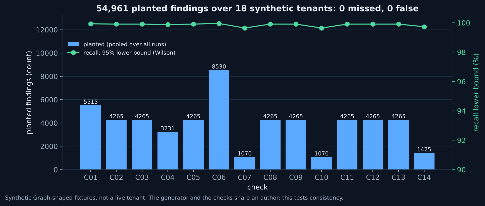
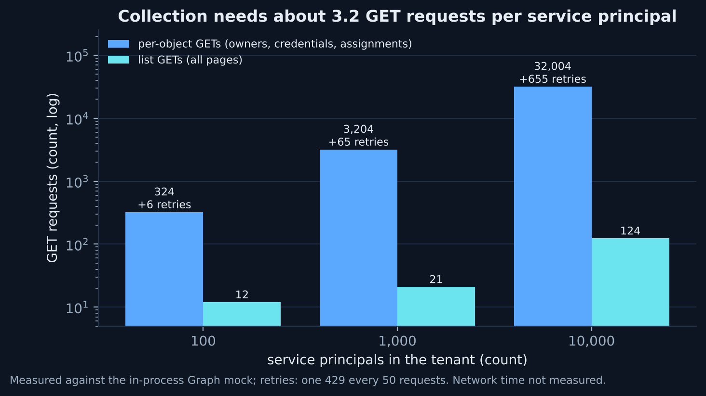
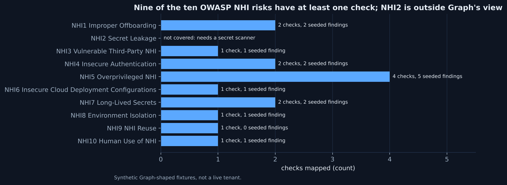
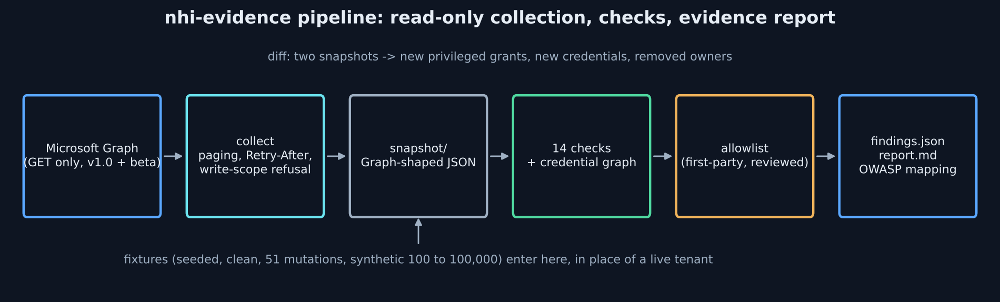

# nhi-evidence

[](https://github.com/itsashutoshpsingh/nhi-evidence/actions/workflows/ci.yml)


**On a seeded test tenant built from Graph-shaped fixtures (not a live tenant), 14 read-only checks found all 15 planted findings from 14 misconfigurations with 0 false findings, and each maps to the OWASP NHI Top 10.**

Read-only evidence of risky non-human identities (apps, service principals, managed, workload and agent
identities) in Microsoft Entra ID, mapped to the [OWASP Non-Human Identities Top 10](https://owasp.org/www-project-non-human-identities-top-10/2025/top-10-2025/).
Refuses to run with write permissions. How it differs from Maester, EIDSCA and BloodHound: [docs/prior_art.md](docs/prior_art.md).

| Test (all synthetic, Graph v1.0/beta schema) | Planted | Found | False | Result file |
|---|---|---|---|---|
| Seeded tenant: 14 misconfigurations, 34 look-alike controls | 15 findings | 15 | 0 | [`seeded_eval.json`](results/seeded_eval.json) |
| of which the guide's 12 static misconfigurations | 13 findings | 13 | 0 | same |
| Clean tenant (seeded tenant with every issue fixed) | 0 | 0 | 0 | same |
| Each of the 14 issues planted alone | 15 findings | 14 of 14 issues exact | 0 | same |
| Single-change mutations of the clean tenant | 51 changes, 81 findings | 81 (51 of 51 exact) | 0 | [`mutations.csv`](results/mutations.csv) |
| Deliberately broken check code (mutants) | 208 mutants | 206 caught (99.0%) | — | [`code_mutants.csv`](results/code_mutants.csv) |
| 18 synthetic tenants, 100 to 100,000 service principals | 54,961 findings | 54,961 | 0 | [`scale_runs.csv`](results/scale_runs.csv) |
| Live seeding plan replayed against a simulated Graph | 12 findings | 12 | 0 | [`lab_plan_replay.json`](results/lab_plan_replay.json) |
| Same checks written as one-line rules (7 tenants) | 728 true | 510 | 4,440 | [`ablation.csv`](results/ablation.csv) |

Every figure above is from synthetic fixtures I built from Microsoft's Graph documentation. They show the
checks do what their rules say, consistently, at scale; they are not a measurement on a real tenant. The
live run is written up step by step in [docs/run-against-your-tenant.md](docs/run-against-your-tenant.md).
A sample report: [`results/seeded_report/report.md`](results/seeded_report/report.md).



## What it checks

| Check | OWASP NHI | Reads | Licence |
|---|---|---|---|
| C01 App or agent identity with no accountable owner | NHI1 | `/applications/{id}/owners` | free |
| C02 Enabled and permissioned, no sign-in for 90 days | NHI1 | `beta /reports/servicePrincipalSignInActivities` | `AuditLog.Read.All` |
| C03 Client secret valid over 180 days, or no end date | NHI7 | `passwordCredentials` on apps **and service principals** | free |
| C04 Expired credentials left, or several active secrets | NHI7 | `passwordCredentials`, `keyCredentials` | free |
| C05 App-only identity using only a secret | NHI4 | credentials, federated credentials, app role assignments | free |
| C06 High-privilege Graph application permission | NHI5 | `/servicePrincipals/{id}/appRoleAssignments` | free |
| C07 All-user consent to sensitive delegated scopes | NHI5 | `/oauth2PermissionGrants` | free |
| C08 Service principal in a role Microsoft labels privileged | NHI5 | `/roleManagement/directory/roleAssignments` | free |
| C09 Loose federated credential ([rules](docs/federation-rules.md)) | NHI6 | `beta /applications/{id}/federatedIdentityCredentials` | free |
| C10 Unverified multi-tenant app holding access | NHI3 | `appOwnerOrganizationId`, `verifiedPublisher` | free |
| C11 One identity for prod and non-prod, or several workloads (review) | NHI8, NHI9 | federated subjects, redirect hosts | free |
| C12 Not covered by an enforced workload identity Conditional Access policy | NHI4 | `/identity/conditionalAccess/policies` | read free; policies need Workload ID Premium |
| C13 Who can add a credential to a privileged service principal | NHI5 | owners, roles, role-assignable groups, app permissions as a graph | free |
| C14 Service account signed in interactively | NHI10 | `/auditLogs/signIns` | Entra ID P1 or P2 |
| NHI2 Secret Leakage: not covered | — | Graph never returns secret values | use a secret scanner |

Each finding carries the Graph fields that triggered it, why it matters, a portal path and Graph query to
verify it by hand, the OWASP risk, the identity type (app, third-party app, managed identity, agent
identity, Microsoft first-party) and a severity raised to at least high on privileged identities.
Microsoft first-party apps and allowlisted apps (each with a written reason) are suppressed and counted.
Citations for each mapping: [docs/owasp-mapping.md](docs/owasp-mapping.md).

## Findings worth knowing

- **One-line versions of the checks make 4,440 false and 218 missed findings on the same seven synthetic
  tenants; the refined checks make none.** The refinements that matter most: ignore disabled and non-human
  owners but accept `serviceManagementReference`; skip apps too new to be "unused"; judge only app-only
  identities for secret-versus-certificate; read Microsoft's own privileged label for roles; count only
  enforced policies and only apps Conditional Access can cover. The totals reflect my generator's mix;
  the per-check pattern is the result ([`ablation.csv`](results/ablation.csv)).
- **A data permission on an app owned by a non-admin is already a privilege path.** Four of my first 42
  hand-written mutation expectations missed this kind of side effect; the tool did not
  ([what went wrong](docs/what-went-wrong.md), item 5).
- **Microsoft's federation docs give the pull-request subject as `pull-request`; GitHub issues
  `pull_request`.** A credential copied from Microsoft's page never matches. Check 9 reports it.
- **A read-only tool cannot see agent identity sponsors.** Graph lists only `AgentIdentity.ReadWrite.All`
  for that call, so the collector skips it and says so.
- **Collection costs about 3.2 Graph requests per service principal** (owners, credentials and assignments
  are per object); all 14 checks then run in 6.3 s with 681 MB peak memory on a 100,000-identity tenant
  (mean of 3 seeds; times move a few percent between runs on a shared machine).

















## How it works



1. **Collect** ([`collect.py`](src/nhi_evidence/collect.py)): GET-only, pinned API version per call,
   follows `@odata.nextLink`, honours `Retry-After`. [`auth.py`](src/nhi_evidence/auth.py) reads the
   token's `roles`/`scp` and stops if anything outside four read permissions (plus sign-in scopes) is
   present. Exact permissions and every request: [docs/permissions.md](docs/permissions.md).
2. **Snapshot**: Graph's own JSON, one file per collection, with a manifest of versions and request counts.
3. **Check**: 14 modules in [`checks/`](src/nhi_evidence/checks/), each `run(snapshot, config)`. Check 13
   builds a small credential-control graph with networkx and reports, for each privileged service
   principal, the shortest path from every non-privileged principal and the control that closes it.
4. **Report**: `findings.json`, `report.md`, `owasp_mapping.md`; `--scrub` pseudonymises IDs and domains.
5. **Diff**: `nhi-evidence diff before/ after/` lists new privileged grants and roles, new credentials on
   privileged identities, removed owners and new all-user consents.

The validation in detail: [docs/method.md](docs/method.md). The seeded tenant and its look-alikes are
defined in one readable file, [`fixtures/seeded.py`](fixtures/seeded.py); per-issue results are in
[`results/tables.md`](results/tables.md).

## Use it

```bash
uv sync --frozen
uv run nhi-evidence check fixtures/seeded_tenant --allowlist fixtures/seeded_tenant/allowlist.json --out out/seeded
uv run nhi-evidence diff fixtures/clean_tenant fixtures/seeded_tenant
# against your own tenant (read-only app registration; see docs/run-against-your-tenant.md)
uv run nhi-evidence collect --tenant-id <id> --client-id <id> --out snapshots/today
uv run nhi-evidence check snapshots/today --out out/today --scrub yourdomain.example
```

Only run the collector on a tenant you own or have written permission to assess.

## Reproduce

```bash
uv sync --frozen
make reproduce   # fixtures, tests, seeded and mutation runs, code mutants, scale to 100,000, cost, ablation, lab replay, charts, summary
```

About two and a half minutes on four cores (2 min 22 s measured); peak memory about 0.7 GB (the
100,000-identity runs). Run times in the results change slightly between runs; every count is identical. `make refs`
re-downloads the reference data from the pinned documentation commits. Versions are pinned in
[`uv.lock`](uv.lock); Python 3.12 or 3.13.

## What went wrong

The full list, with the effect of each on the numbers: [docs/what-went-wrong.md](docs/what-went-wrong.md).
In short: no live tenant was available, so nothing here is a field result; the first code-mutation run
caught only 80.2% of mutants, and closing the gaps exposed one real defect (disabled service principals
were treated as path targets); my first synthetic tenants had expired secrets I did not intend, which
check 4 correctly reported; four of my mutation expectations were wrong where the tool was right; the
live seeding plan first produced two unplanned findings in replay; agent sponsors and granted-versus-used
are out of reach of a read-only, tenant-free build. Limits: [docs/limits.md](docs/limits.md).

## Not done yet

- The live-tenant run and the OWASP detection-index pull request (entry drafted in
  [docs/owasp_entry.md](docs/owasp_entry.md)).
- Granted versus used from Microsoft Graph activity logs (needs a P1 or P2 trial and Log Analytics).

## Licence

MIT. Copyright Ashutosh Pal Singh.
